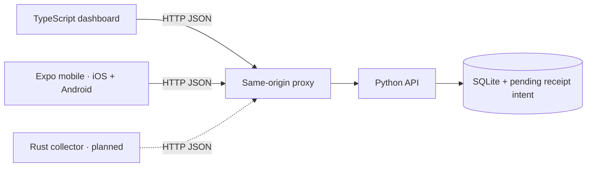

# One product, explicit responsibilities

Solid arrows are implemented in source. Dashed arrows are the roadmap. Mobile bundle checks and device execution are separate verification levels. The web browser never opens SQLite; clients do not share a database.

Python owns observation validity, uniqueness, durable request bindings and receipt intent. Reading/key/event writes form one SQLite transaction.
Receipt preview delivery and acknowledgement are separate steps, so uncertainty can be recovered using a stable event identity.
The browser captures one submission intent and reuses its request key/content until the user explicitly starts another submission. It does not yet persist drafts across reloads.

## SOLID evidence

| Principle | Concrete seam | Evidence |
| --- | --- | --- |
| SRP | HTTP, domain validation, storage and receipt policy are separate modules | Invalid input never writes; sink failure never acknowledges |
| OCP | Exporters are composed through a captured registry | A new renderer runs through unchanged export policy |
| LSP | Memory and SQLite satisfy the same observable storage contract | Shared contract tests check replay, conflict, paging and immutable projections |
| ISP | Lookup, paging, writing and queue capabilities have separate ports | Export policy works with a pager-only fixture |
| DIP | Policies accept protocols; the executable chooses concrete adapters | Tests inject failing queues, writers and sinks |

SOLID governs boundaries inside each application. Four languages or four directories do not themselves demonstrate SOLID.

## Deliberate limits

One API instance with SQLite and a persistent volume is enough for this learning slice. Do not scale replicas sharing this SQLite file. No authentication, tenant separation, backups, autonomous receipt worker, queue leases or public hosting is configured.
The web proxy caps request bodies at 16 KiB; a directly exposed API needs an equivalent edge limit. Compose binds the web port to loopback and does not publish the API port.
Before public deployment: choose identity/access rules, HTTPS, a backup/restore procedure, resource limits and a hosting/storage model. This is preparation for deployment, not a claim that it is already hosted.

## Repository decision

Keep the four principle workbooks independent. This monorepo owns the integrated product, shared API contract and cross-component checks. It does not depend on sibling folders, Git submodules or unversioned local packages.
The Python backend was adapted from `solid-principles-python` commit `b38820a516ab92ece53ff84ebe1b09c5fcbdf1da` under MIT. The teaching repository and this product can evolve independently; no ongoing copy-sync is required.

## Cross-platform client decision

Swift depth stays in the existing native study repository. This product uses Expo/React Native to target iOS and Android with TypeScript. Browser and mobile consume a shared workspace package for HTTP/validation; platform-specific rendering and storage stay in their applications.
The mobile persistence port holds exactly one immutable submission intent and its endpoint. Save precedes send; a matching acknowledgement precedes clear. Network errors, conflicts, and failed local clearing retain original intent. No reconnect scheduler or background-task promise is made.
AsyncStorage is an adapter, not a dependency of the pending-submission policy. Tests simulate failed storage and a recreated policy instance. A native restart test is still a separate requirement.
