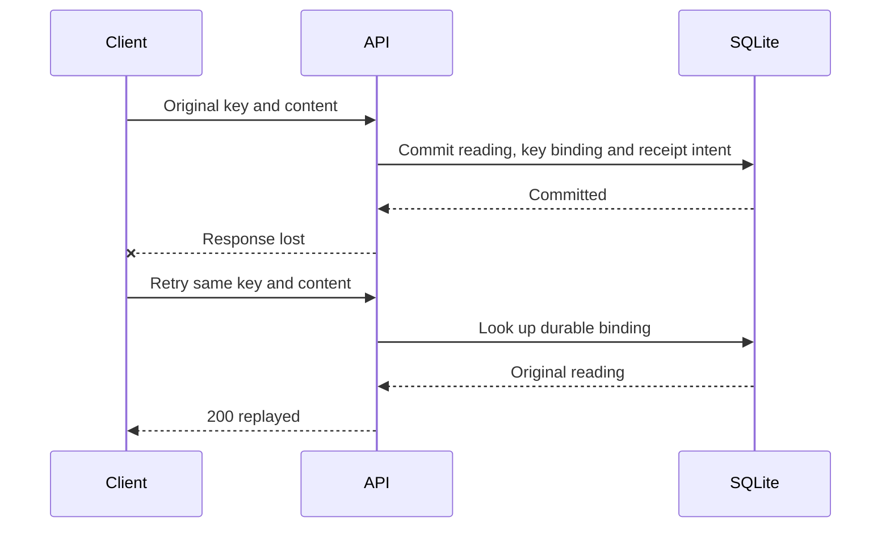

# One observation, five design principles

Allow approximately 45 minutes after setup. This lesson is for developers who can read basic HTTP/JSON and some Python or TypeScript. No prior SOLID knowledge is required. Work locally with synthetic observations.

By the end, you should be able to:

- Trace one submission from the screen to durable storage and name each layer's responsibility.
- Predict created, replayed and conflicting requests before running them.
- Explain why a timeout leaves a write unconfirmed and what a safe retry preserves.
- Use shared storage contracts and narrow interfaces to explain substitutability and dependency direction.
- Add an exporter registration without changing export policy, then explain the limits of that example.

Start the stack using the [README](../README.md#quick-start). If setup fails, use [troubleshooting](TROUBLESHOOTING.md). The examples below use Docker at port 8080. For `make dev`, change the base to `http://127.0.0.1:5180/api`.

## 1. See the result before reading the internals — 5 minutes

Open the dashboard. Enter a fresh observation identity, station `North ridge` and Kelvin `281.25`. Click **Record observation**. Locate that identity in the ledger and check for **8.10 °C**.

Kelvin is the stored measurement; Celsius is a presentation choice. An observation is an immutable record identified by the identity you entered. A request key identifies submission intent and is a separate value.

Before continuing, explain to a partner: which value identifies the observation, and which value should survive a network retry? If the distinction is unclear, the next experiment makes it visible.

## 2. Predict, submit, replay, conflict — 10 minutes

In one terminal session, prepare a unique identity and one immutable request body. Keep these variables for every command in this section. The suffix avoids collisions with earlier runs; it is not a production key-generation recommendation.

```sh
LESSON_BASE=http://127.0.0.1:8080/api
LESSON_ID="lesson-$(date +%s)-$$"
LESSON_KEY="$LESSON_ID-request"
LESSON_BODY="{\"identity\":\"$LESSON_ID\",\"station\":\"North ridge\",\"kelvin\":281.25}"
```

Predict the status of the first request, then run it:

```sh
curl -i "$LESSON_BASE/readings" \
  -H 'Content-Type: application/json' \
  -H "Idempotency-Key: $LESSON_KEY" \
  --data "$LESSON_BODY"
```

Expect **201** and `outcome: created`. Now predict what happens if the exact command runs again, then repeat it. Expect **200** and `outcome: replayed`, with the same stored reading and sequence. This is idempotency here: repeating the same accepted intent does not append another observation.

Keep the key but change the measurement:

```sh
curl -i "$LESSON_BASE/readings" \
  -H 'Content-Type: application/json' \
  -H "Idempotency-Key: $LESSON_KEY" \
  --data "{\"identity\":\"$LESSON_ID\",\"station\":\"North ridge\",\"kelvin\":282}"
curl -i "$LESSON_BASE/readings/$LESSON_ID"
```

Expect **409** for the changed request. The GET still returns `kelvin: 281.25`. Refresh the dashboard and locate the original reading. Use a new observation identity AND a new key for a genuinely new observation.

**Check:** why would a new key with the old observation identity also conflict? The system protects immutable observation identities as well as request bindings. See the [contract](../contracts/README.md#submission-rules).

## 3. Follow the responsibilities — 10 minutes

Read these entry points in order; you do not need to read every implementation:

| Stop | What it owns | Principle made concrete |
| --- | --- | --- |
| [Web controller](../apps/web/src/main.ts) and [HTTP client](../packages/notebook-client/src/index.ts) | Capture intent, send and validate acknowledgements | SRP: presentation and transport have separate work |
| [HTTP mapping](../services/api/src/field_notebook/http.py) and [domain](../services/api/src/field_notebook/domain.py) | Translate HTTP and enforce observation rules | SRP: transport concerns and domain validity can change separately |
| [Policy](../services/api/src/field_notebook/policy.py) and [ports](../services/api/src/field_notebook/ports.py) | Orchestrate through required capabilities | DIP: policy accepts abstractions; ISP: consumers request focused capabilities |
| [Executable](../services/api/src/field_notebook/__main__.py) | Select and connect concrete adapters | DIP: adapter choice lives at the composition boundary |
| [Memory](../services/api/src/field_notebook/memory.py), [SQLite](../services/api/src/field_notebook/sqlite_store.py) and `StoreContract` in [tests](../services/api/tests/test_backend.py) | Preserve observable record, replay, conflict and paging rules | LSP: adapters must honour the same promises |

SOLID names design principles, not network-delivery guarantees. A protocol alone cannot prove that an adapter behaves correctly. The shared contract tests supply behavioural evidence. Memory and SQLite can satisfy that contract while having different restart durability; the SQLite-specific tests cover persistence.

**Check:** if temperature validation changes, where should the rule live? If storage changes, which tests should still pass? Explain each answer in terms of responsibility or observable behaviour, rather than counting interfaces.

## 4. Explain uncertainty — 10 minutes

Consider two possible histories:



In the other history, the request never reaches the server at all. From a timeout alone, the client cannot distinguish them. That is why it says unconfirmed and preserves the original intent.

Demonstrate an unavailable API using the [recording checklist, steps 4–6](RECORDING.md#capture-checklist). Keep the browser tab open. An unavailable API demonstration is different from deliberately dropping the response AFTER commit. The latter is exercised in the browser test named `lost acknowledgement retries identical intent without creating another row` in [notebook.spec.ts](../apps/web/tests/notebook.spec.ts).

With the development dependencies and Playwright Chromium installed, run that focused test from the repository root:

```sh
npm --prefix apps/web test -- --grep 'lost acknowledgement'
```

The test commits through the real API, drops the first response, checks identical retry content/key and verifies one matching row. Its servers use isolated test data; stop any other test run using ports 5181 or 8011 first.

**Check:** does this prove exactly-once delivery to an arbitrary email service? No. The receipt sink is a local preview, and external side effects need their own delivery and deduplication contracts. Web intent is tab-local; mobile saves one pending intent. Neither client promises a background batch-sync engine.

## 5. Extend one seam — 10 minutes

Open [exports.py](../services/api/src/field_notebook/exports.py). `export_page` requests a page, then delegates rendering through a captured registry. It does not contain branches for every output format.

**Exercise:** without editing `export_page`, create an in-memory notebook, record one observation, and register a renderer named `count` that produces the number of rows as plain text. Work in a scratch script or a local exercise branch; this lesson does not require changing the shipped app or adding an HTTP format.

Acceptance checks: the artifact body is `1`, its media type is `text/plain`, and the next cursor is `None`. Explain why this renderer needs neither write access nor receipt-queue access.

<details>
<summary>Reference solution and how to run it</summary>

After `make setup`, run from the repository root:

```sh
PYTHONPATH=services/api/src services/api/.venv/bin/python - <<'PY'
from field_notebook.domain import Observation
from field_notebook.exports import Artifact, Exporters, export_page
from field_notebook.memory import MemoryNotebook

def count_export(readings):
    return Artifact(str(len(readings)), "text/plain")

store = MemoryNotebook()
store.record(Observation("exercise-one", "North ridge", 281.25), "exercise-key")
registry = Exporters((("count", count_export),))
artifact, cursor = export_page(store, registry, "count", 0, 25)
assert artifact.body == "1"
assert artifact.media_type == "text/plain"
assert cursor is None
print(artifact.body)
PY
```

This counts the current page, not the entire database. OCP here means the export policy stays unchanged when a renderer is registered. Wiring a new renderer into the deployed application would still be a deliberate configuration change. ISP appears in the pager-only dependency; the test `test_read_only_fixture_exports_without_write_methods` demonstrates it with a fixture that cannot write.

</details>

## Explain it back

Give a one-minute explanation of the lost-response case to another developer, then a one-sentence explanation to a non-technical teammate. Preserve the distinction between “not confirmed” and “not stored” in both versions.

Ready to continue? Compare [mobile storage and lifecycle](../apps/mobile/README.md#study-the-boundaries), inspect the [architecture trade-offs](ARCHITECTURE.md), or use the [workshop guide](WORKSHOP.md) to teach the same material. For deeper language-specific exercises, follow the four workbooks linked in the root README.
